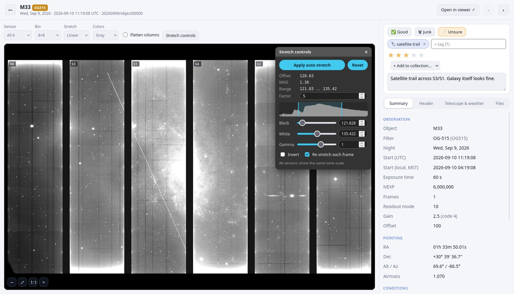

# CMOS Browser

A web application for looking through the images taken by the telescope's CMOS
camera. The images are stored on a shared server, one folder per observing
night. CMOS Browser runs on that server and shows them in Firefox as a
searchable gallery. You can open any image, adjust its display, read its
technical details, download the original files, and mark images as good or
bad together with the rest of the team.



New users should start with the [user guide](docs/USER_GUIDE.md), which
explains how to get access, install the application and use it, with
screenshots. The rest of this README is reference material for setup and
maintenance.

## Overview

- The data is read-only. The application never writes to the data folder
  (`/storage/hdd/cmos` on the current server); everything it creates is stored
  in its own directory.
- Each user runs their own copy in their own remote desktop session, on their
  own port. Copies do not depend on each other.
- The code is hosted in this public repository and contains no data. Copies
  update themselves from `main`.
- Verdicts, tags, ratings and notes are synchronized between users through the
  private repository `ChristineMountain/cmos-ratings`.

## Requirements

- A user account on the server with remote desktop access.
- A GitHub account with access to `cmos-ratings`. Annotations are recorded
  under the GitHub username.

## Installation

Run the following in a terminal inside the remote desktop on the server:

```bash
bash <(curl -fsSL https://raw.githubusercontent.com/ChristineMountain/cmos-browser/main/install.sh)
```

The installer sets up a Python environment with micromamba, clones this
repository to `~/cmos-browser`, signs in to GitHub, clones the ratings
repository, assigns a personal port, builds the index, and adds a desktop
launcher and an autostart entry. It can be re-run safely to repair or complete
an installation; existing annotations are kept.

## Usage

Start the application with the CMOS Browser desktop launcher. It runs
`run.sh open`, which updates the code, starts the server and opens it in
Firefox. The server is also started at login and restarted by a watchdog if it
stops.

`run.sh` commands:

| Command | Description |
|---|---|
| `./run.sh open` | Update, start, and open in Firefox (used by the launcher) |
| `./run.sh start` / `stop` / `restart` | Control the server |
| `./run.sh status` | Show whether the server is running and its address |
| `./run.sh index [--only NIGHT] [--rebuild]` | Update the index |
| `./run.sh update` | Pull the latest version from GitHub |
| `./run.sh watchdog` | Keep the server running and up to date (started at login) |
| `./run.sh editlink` | Print a link that enables editing from another browser |

## Contacts

| Request | Contact |
|---|---|
| Server account | A server administrator (members of the `sudo` group) |
| Access to `cmos-ratings`, bugs, questions | Maintainer: [@ChristineMountain](https://github.com/ChristineMountain) |

## Configuration

`config.toml` holds the shared settings and is tracked in git.
`config.local.toml` holds per-user settings (GitHub username, port), is not
tracked, and overrides `config.toml`.

| Setting | Description |
|---|---|
| `data_root` | Data directory. A list is allowed; the first existing path is used. |
| `include` | Glob patterns, relative to `data_root`, for the folders to index |
| `port` | Server port. Set per user in `config.local.toml`. |
| `auto_refresh_minutes` | Interval for automatic re-indexing (0 disables it) |
| `viewer_url`, `viewer_root` | Link format for the port-8003 image viewer |
| `cache_max_mb`, `min_free_mb` | Thumbnail cache limits |
| `everyone_can_edit`, `safe_sharing` | Access control for visitors other than the owner of the copy |
| `local_utc_offset_hours` | Offset of the times in `*_meta.json` (Arizona, -7) |

Restart the server after changing the configuration.

### Indexing

The server re-indexes every 15 minutes at low priority; only new or changed
exposures are read. To index manually, for example right after an observing
run:

```bash
./run.sh index                    # all folders matched by `include`
./run.sh index --only 20260915    # a single folder
./run.sh index --rebuild          # re-read everything
```

A full rebuild takes under a minute. The index stores `data_root` and is
rebuilt automatically if the data directory changes.

### Adding folders

Add a pattern to `include` in `config.toml` and run `./run.sh index`. Ask the
owner of a folder before adding it.

```toml
include = [
  "[0-9][0-9][0-9][0-9][0-9][0-9][0-9][0-9]",   # dated night folders (default)
  "someone/project/*/*",
]
```

Removing a pattern and re-indexing removes those exposures from the index.

### Image viewer links

Each exposure links to the existing image viewer on port 8003, which provides
astrometry and catalog overlays. The links are built from `viewer_url` and
`viewer_root`. The viewer runs on the Docker host, which is reachable from the
remote desktops at `172.18.0.1:8003`.

## Maintenance

### Adding a user

1. The user obtains a server account from an administrator.
2. The user sends their GitHub username to the maintainer.
3. The maintainer invites them to `cmos-ratings` with write access, either under
   Settings > Collaborators > Add people, or with:

   ```bash
   gh api -X PUT repos/ChristineMountain/cmos-ratings/collaborators/USERNAME -f permission=push
   ```

4. The user runs the installer, or runs it again if already installed. The
   installer accepts the invitation. Invitations expire after 7 days.

No invitation is needed for this repository, since it is public. To revoke
access, remove the user under Collaborators; their ratings file remains in the
repository until deleted.

### Transferring maintenance

Inviting users and publishing changes require admin access to both
repositories. Before the maintainer leaves:

1. In `cmos-ratings`, Settings > Collaborators: change the new maintainer's role
   to Admin.
2. In `cmos-browser`, Settings > Collaborators: add the new maintainer as Admin.
3. Update the [Contacts](#contacts) table.

The repositories remain under the original account and keep working as long as
that account exists. If it will be deleted, transfer both repositories
(Settings > General > Transfer ownership) and replace `ChristineMountain` in
`install.sh`, `README.md` and `docs/USER_GUIDE.md`. Existing copies continue to
update through GitHub's redirect.

### Publishing changes

Test changes locally (`./run.sh restart` and reload the page), then:

```bash
git add -A
git commit -m "Describe the change"
git push
```

Running copies pick up the change within five minutes or the next time they
are opened. Since every copy updates automatically, test before pushing. To
roll back the last change: `git revert HEAD && git push`.

If `environment.yml` changes, copies install the new packages on update.

### Documentation screenshots

The images in `docs/images/` were taken from a separate copy with sample
annotations, so that no real notes are published. Use the same approach when
updating them.

## Project layout

| Path | Description |
|---|---|
| `app.py` | Web server (FastAPI) |
| `index.py` | Builds the SQLite index from FITS headers and `*_meta.json` |
| `cmosdata.py` | Read-only access to FITS, zstd and pack files |
| `sync.py` | Synchronizes annotations with the ratings repository |
| `static/` | Front end (plain HTML, CSS and JavaScript) |
| `run.sh` | Control script |
| `install.sh` | Installer |
| `environment.yml` | Python dependencies |
| `config.toml` | Shared configuration |
| `docs/` | User guide and screenshots |

Generated files, not tracked:

| Path | Description |
|---|---|
| `config.local.toml` | Per-user configuration |
| `index.sqlite` | Exposure index (about 4 MB) |
| `userdata.sqlite` | Collections and annotations. Back this up. |
| `ratings-data/` | Clone of the ratings repository |
| `cache/thumbs/` | Thumbnail cache (WebP) |
| `edit_key.txt` | Key for `./run.sh editlink` |
| `server.log`, `watchdog.log` | Logs |
| `.env/` | Python environment |

## Resource usage

The server is shared, so the application is deliberately conservative:

- The server runs at `nice 10` and reads at most two images at a time.
  Indexing runs at `nice 19` with low I/O priority.
- Thumbnails are generated when a card scrolls into view (two at a time, about
  one second each), cached on disk up to 200 MB, and not written when free
  space is below 500 MB.
- Viewer previews are binned (4x4 or 8x8 by default) and transferred once;
  stretching happens in the browser. At most 64 MB of previews are kept in
  memory.
- Late frames of compressed files (`.fits.zst`, `.hpkcmos-pack.zst`) are not
  served, since they would require long decompression.

## Data notes

- An exposure consists of `objectNNNNN_meta.json` and up to six sensor files
  `objectNNNNN_0` to `_5`, as FITS, `.fits.zst` or raw `.hpkcmos-pack(.zst)`.
- Raw pack files are decoded by `read_pack_frame` in `cmosdata.py`, which was
  verified pixel for pixel against FITS files converted from the same captures.
  FITS is used when both exist. Sensors may store different numbers of frames.
- Exposure time is taken from the FITS `EXPTIME` keyword when available,
  otherwise computed as `NEXP x line time` (10 us in mode 10, 33.3 us in mode
  12). In 2025 files, `EXPTIME` held the NEXP count; this is handled.
- Times in `*_meta.json` are Arizona local time (UTC-7). The application
  displays UTC.
- Filter names are normalized for filtering (`OG-515` to `OG515`, `DD051` to
  `DDO51`); the original value is displayed.
- Sensors are displayed in their on-sky arrangement (0, 3, 1, 4, 2, 5 from left
  to right, with 3 to 5 rotated by 180 degrees), derived from the WCS headers.
- Thumbnails subtract the median of each column. The viewer shows raw values
  unless "Flatten columns" is enabled. The data files are never modified.
- Some files are not readable by all accounts (many June 2026 nights). These are
  marked "no access".

## Troubleshooting

See the [troubleshooting section](docs/USER_GUIDE.md#troubleshooting) of the
user guide. In addition:

- "Couldn't update": files in `~/cmos-browser` have local changes. Check with
  `git -C ~/cmos-browser status`, or re-run the installer to restore the
  released version.
- For other errors, check `server.log` and run `./run.sh restart`.
