# CMOS Browser user guide

CMOS Browser lets you look through the CMOS camera data on the server from
Firefox: browse by night or object, preview images, read headers and
telescope/weather data, judge and tag photos with the team, and download the
original files.

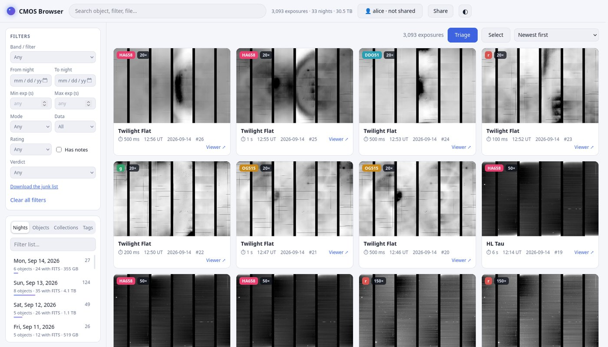

**Contents**

1. [Getting access (new people start here)](#1-getting-access-new-people-start-here)
2. [Installing](#2-installing)
3. [Opening the app](#3-opening-the-app)
4. [Finding exposures](#4-finding-exposures)
5. [Looking at an exposure](#5-looking-at-an-exposure)
6. [Judging photos: verdicts, tags, stars, notes](#6-judging-photos-verdicts-tags-stars-notes)
7. [Triage: going through many photos fast](#7-triage-going-through-many-photos-fast)
8. [Working on many photos at once](#8-working-on-many-photos-at-once)
9. [Collections](#9-collections)
10. [Sharing links](#10-sharing-links)
11. [Downloading files and exporting lists](#11-downloading-files-and-exporting-lists)
12. [Keyboard shortcuts](#12-keyboard-shortcuts)
13. [Troubleshooting](#13-troubleshooting)

---

## 1. Getting access (new people start here)

There is no separate CMOS Browser account. You need two things:

| What | Who gives it to you | Why |
|---|---|---|
| **A login on the server** (the remote desktop) | A server admin | The app runs in your own remote desktop, where the data is. |
| **A free GitHub account**, invited to the team's ratings repo | The CMOS Browser maintainer (see the [README](../README.md#who-to-ask)) | Your verdicts, tags, ratings and notes are saved under your GitHub name and shared with the team. |

Steps:

1. **Ask a server admin for a login.** You get a username and password for the
   remote desktop.
2. **Make a GitHub account** at <https://github.com/signup> if you don't have one
   (free).
3. **Send your GitHub username to the maintainer**, so they can invite you to
   the ratings repo. You can install before the invite arrives; sharing starts
   once it's there.

## 2. Installing

You do this **once**.

1. Log in to your **remote desktop on the server** and open a **Terminal**
   (Applications menu → Terminal Emulator).
2. Paste this line and press Enter:

   ```bash
   bash <(curl -fsSL https://raw.githubusercontent.com/ChristineMountain/cmos-browser/main/install.sh)
   ```

3. Wait about 5 minutes. When it asks you to **sign in to GitHub**, it shows a
   short code and opens a page in Firefox. Paste the code there and click
   **Authorize**. The installer won't continue without it.
4. When it says **Done**, a **CMOS Browser** icon is on your desktop.

Running the installer again is always safe: it repairs or finishes an install
and keeps your ratings and notes. **Run it again after you get the GitHub
invitation** if you installed before (invitations expire after 7 days, so ask
for a new one if yours did).

## 3. Opening the app

Double-click **CMOS Browser** on your desktop. If the desktop asks whether to
trust the launcher, choose *Launch Anyway* / *Mark as trusted*.

The icon updates the app to the latest version, starts it, and opens it in
Firefox. It also starts by itself when you log in, and restarts itself if it
stops. Everyone has their own copy with its own address (for example
`http://localhost:8203/`). The icon always opens the right one.

The **top bar** shows:

- **The search box.**
- **Totals**: how many exposures and nights are indexed. Hover to see when the
  data was last scanned. New data appears by itself within about 15 minutes.
- **👤 your name · synced 2 min ago**: whether your ratings are shared with the
  team. Click it to sync right away. It turns red if the last sync failed;
  hover over it to see why. *not shared* means GitHub isn't set up for your
  copy yet (see [Troubleshooting](#13-troubleshooting)).
- **Share** (see [Sharing links](#10-sharing-links)) and **◐** to switch between
  light and dark mode.

## 4. Finding exposures

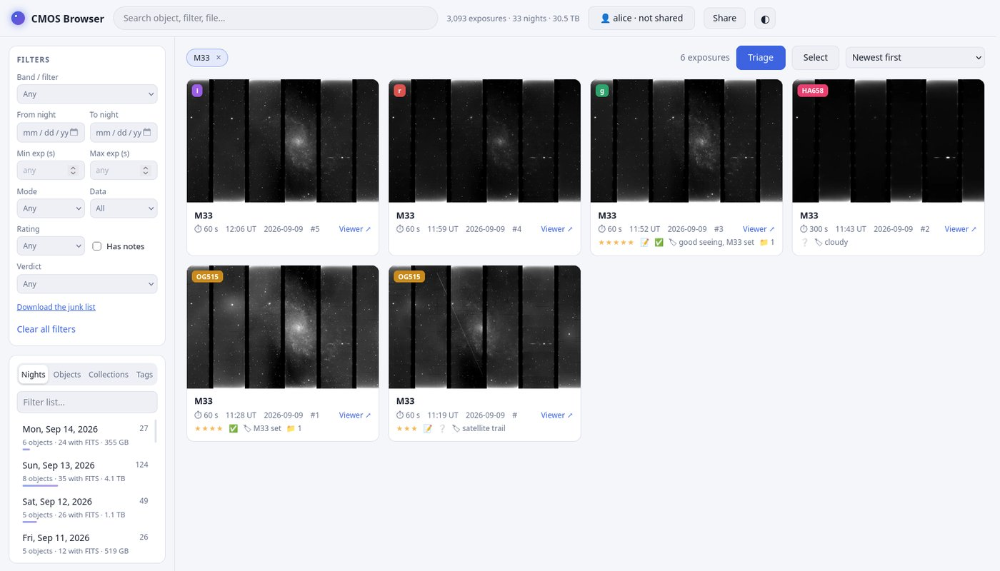

**The sidebar list** (lower left) has four tabs:

- **Nights**: every observing night, newest first, with how many objects,
  exposures and FITS files it has. Click a night to show its exposures.
- **Objects**: every target name. Click one to show all its exposures.
- **Collections**: your own named groups (see [Collections](#9-collections)).
- **Tags**: every tag anyone on the team has used, how many photos have it, and
  who used it. Click one to show those photos.

Type in *Filter list…* to narrow any of these lists.

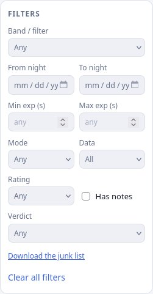

**Filters** (upper left) narrow things down further: band/filter, a range of
nights, exposure time, readout mode, data type, your star rating, *Has notes*,
and **Verdict** (Good / Junk / Unsure by anyone, *Not judged by anyone*, or
*Not judged by me*). Active filters show as chips above the gallery; click a
chip's × to remove it, or **Clear all filters**.

**Sort** with the menu at the top right of the gallery (newest first, oldest
first, highest rated, …).

**Each card** shows a thumbnail of all sensors, the filter (colored badge), the
exposure time, the start time in UT, the night and the exposure number. Under
it you see the stars, 📝 if there's a note, the verdicts (🗑 2 · ✅ 1 means two
people said junk and one said good; red when people disagree), the tags, and 📁
with the number of collections it's in. **Viewer ↗** opens it in the separate
port-8003 image viewer.

<br clear="right">

### Searching

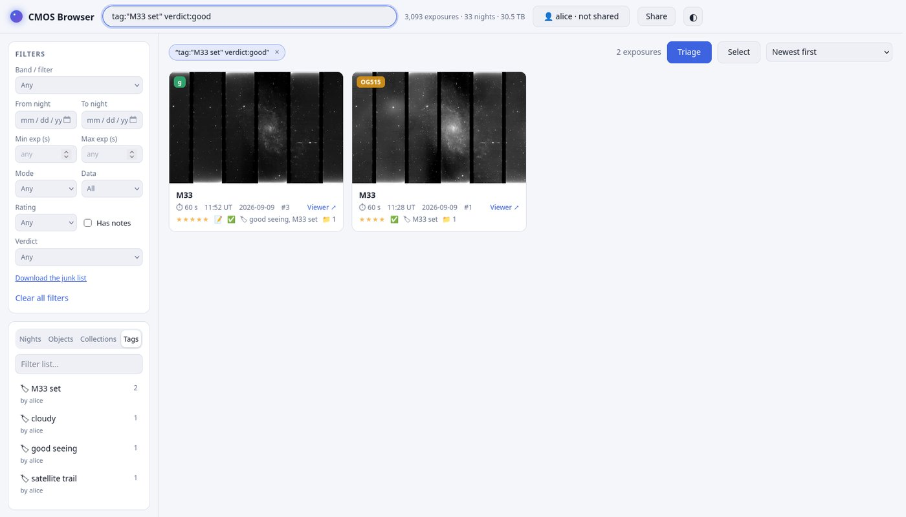

The search box finds object names, filters and file names, and also
understands these words, which you can combine:

| Type | Finds |
|---|---|
| `M33` | Object names, filters, file names, tags and your notes containing "M33" |
| `tag:cloudy` | Photos tagged *cloudy* |
| `tag:"satellite trail"` | Tags with spaces need quotes |
| `verdict:good` / `verdict:junk` / `verdict:unsure` | Photos someone judged that way |
| `night:20260914` | One night |

Example: `tag:"M33 set" verdict:good` shows the good photos in the *M33 set*.

## 5. Looking at an exposure

Click a card to open the exposure.

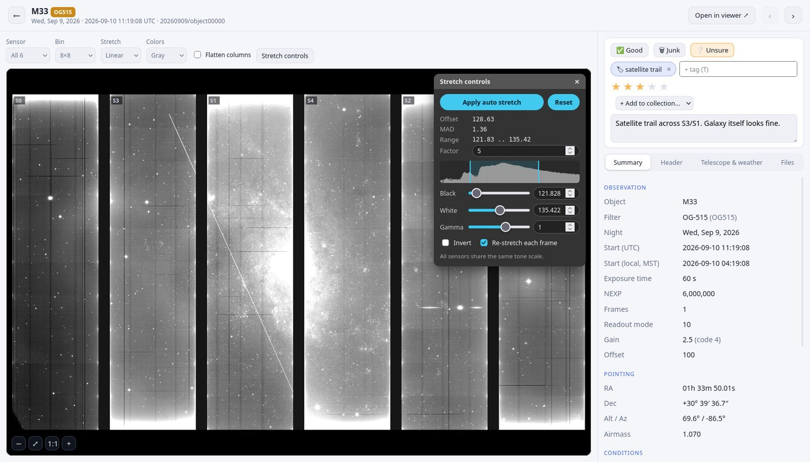

**Top bar:** ← goes back to the gallery, **Open in viewer ↗** opens this
exposure in the port-8003 viewer (which can do astrometry and catalogs),
and ‹ › go to the previous/next exposure in your current list.

**Image toolbar:**

- **Sensor**: all 6 sensors, or a single one at higher resolution.
- **Bin**: how much the preview is shrunk (8×8 is fast; 2×2 shows more detail).
- **Stretch**: linear or other scalings. **Colors**: gray or a color map.
- **Flatten columns**: subtracts each column's median so faint stars stand out
  against the column pattern. The data itself is never changed.
- **Stretch controls** opens the floating panel.

**The sensors are shown as they sit on the sky**: left to right 0, 3, 1, 4, 2,
5, with sensors 3–5 rotated by 180°, and the real gaps between them.

### Stretch controls

- **Apply auto stretch** (or `A`): Black = median − Factor × MAD,
  White = median + Factor × MAD (the same as the CMOS Viewer). Factor starts at
  5. Every exposure opens auto-stretched.
- **Black / White / Gamma**: drag the sliders, type a value, or drag the two
  markers on the histogram. Gamma above 1 brightens the mid-tones.
- **Invert** swaps black and white. **Reset** goes back to the defaults.
- **Re-stretch each frame**: on, every frame gets its own auto stretch; off,
  the levels stay fixed so you can see brightness change between frames.
- All sensors share one tone scale, so their brightness can be compared.

Drag the panel by its title bar, close it with ×, and bring it back with
**Stretch controls** or `S`.

### Zoom, pan and pixel values

Scroll to zoom, drag to pan. The buttons in the lower left are zoom out, fit
(⤢, or double-click the image), 1:1 (one image pixel per screen pixel) and zoom
in. When you hover over the image, the **pixel inspector** (lower right) shows
the sensor, the pixel position and its value.

### Exposures with many frames

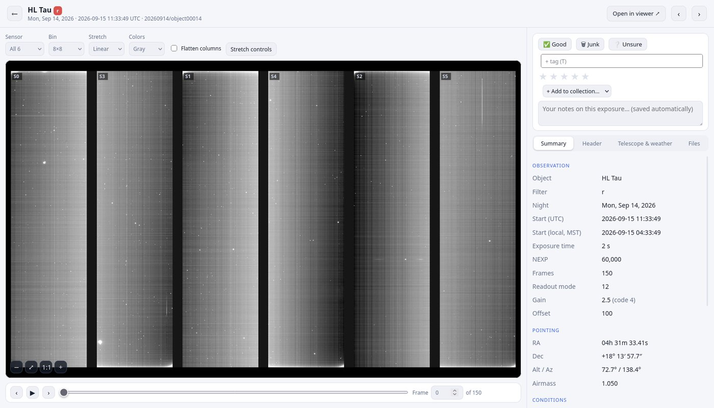

Exposures with more than one frame get a **frame bar** under the image. Drag
the slider to scrub through frames (only the frame you stop on is read, so
dragging is safe), use ‹ › or `[` `]` to step one frame, and ▶ or `P` to play
them in a loop. You can also type a frame number.

### The information tabs

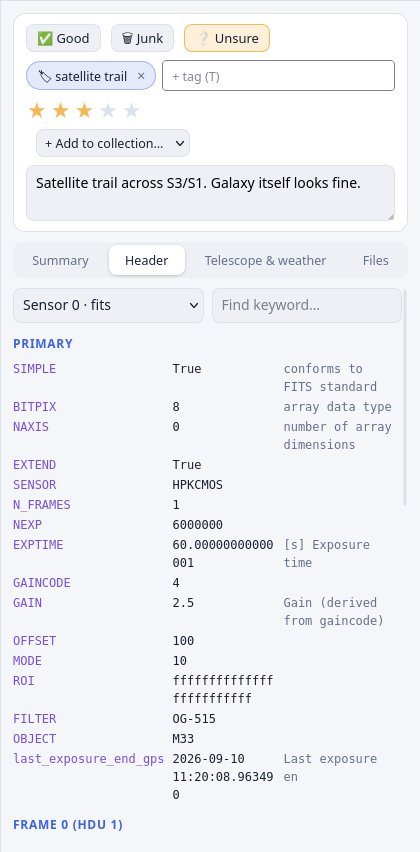

Under the judging panel on the right:

- **Summary**: object, filter, times (UTC and Arizona local time), exposure
  time, frames, readout mode, gain, pointing (RA/Dec, Alt/Az, airmass) and
  weather.
- **Header**: the full FITS header of each sensor file. Pick the file at the
  top and type in the box to find a keyword.
- **Telescope & weather**: everything in the `*_meta.json` file: capture
  settings, telescope samples during the exposure, and weather.
- **Files**: every file of this exposure, its format and size, with
  **Download** buttons (the original file, byte for byte).

<br clear="right">

## 6. Judging photos: verdicts, tags, stars, notes

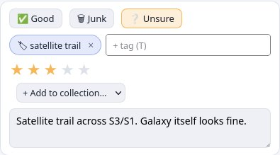

At the top right of every exposure:

- **Verdict**: ✅ **Good**, 🗑 **Junk** or ❔ **Unsure**. One per person per
  photo. Click it again to clear it. **Junk only marks the photo; nothing is
  ever deleted.**
- **Tags**: type in *+ tag* and press Enter. Use them like categories:
  `satellite trail`, `cloudy`, `focus test`, `good seeing`… While you type, the
  app suggests tags people already use, so the team ends up using the same
  words. Capitals don't matter. Click × on a tag to remove it.
- **Stars**: click to rate 1–5 (click the same star again to clear).
- **Collections**: add the photo to one of your collections, or remove it.
- **Notes**: type anything. Notes save automatically.

**Your verdicts, tags, stars and notes are shared with the team** a few seconds
after you change them. Everyone else's appear on each photo's page under
**Others**, and everyone's tags are searchable. Everything is saved on your
copy first, so the app works fine offline; it catches up later.

## 7. Triage: going through many photos fast

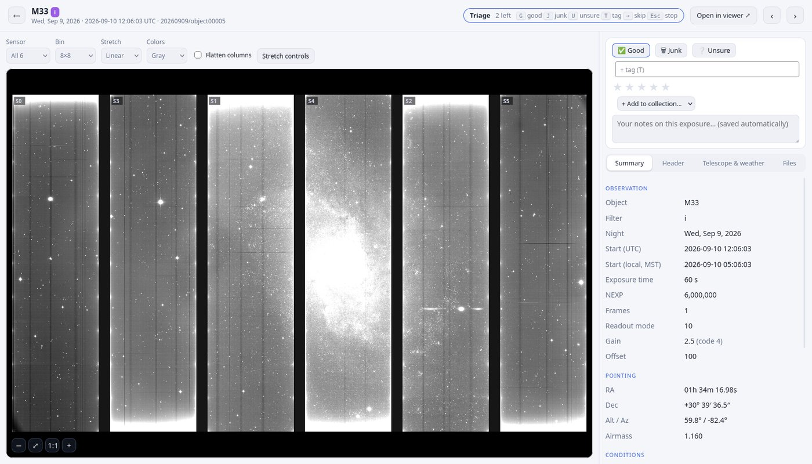

**Triage** (the blue button above the gallery) goes through the photos you
haven't judged yet, one at a time, within whatever you're looking at: a
night, an object, a search. The top bar shows how many are left and the keys:

| Key | Does |
|---|---|
| `G` / `J` / `U` | Good / Junk / Unsure, then the next photo |
| `T` | Type a tag (`Enter` adds it, `Esc` goes back) |
| `→` | Skip this photo for now |
| `1`–`5` | Star rating |
| `Esc` | Stop triage |

## 8. Working on many photos at once

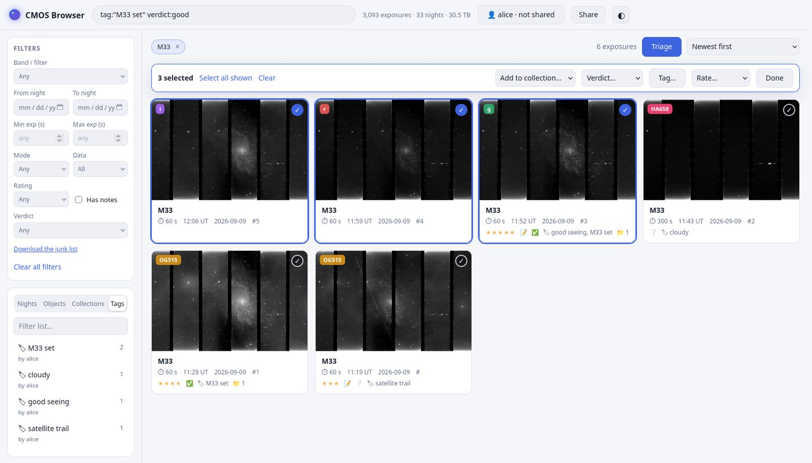

Click **Select** above the gallery, then click cards to pick them (or **Select
all shown**). The bar at the top then lets you:

- **Add to collection…** (or *Remove from this collection* inside one)
- **Verdict…**: give them all the same verdict
- **Tag…**: add a tag to all of them; type `-cloudy` to remove a tag
- **Rate…**: give them all the same stars

Click **Done** to leave select mode.

## 9. Collections

Collections are your own named groups, like *Best M33 frames* or *Flats for
June*. A photo can be in any number of them.

- **Make one**: sidebar → **Collections** → **+ New collection**.
- **Add photos**: on a photo's page (*+ Add to collection…*), or many at once
  with **Select**.
- **Open one** from the sidebar to see only its photos. You can sort by
  *Recently added*, **Rename** it, **Export file list** (a text file with the
  full paths of the original files, handy for scripts) or **Delete** it.
  Deleting a collection only removes the grouping; the photos and files stay.

Collections are **only on your copy**. They aren't shared with the team.

## 10. Sharing links

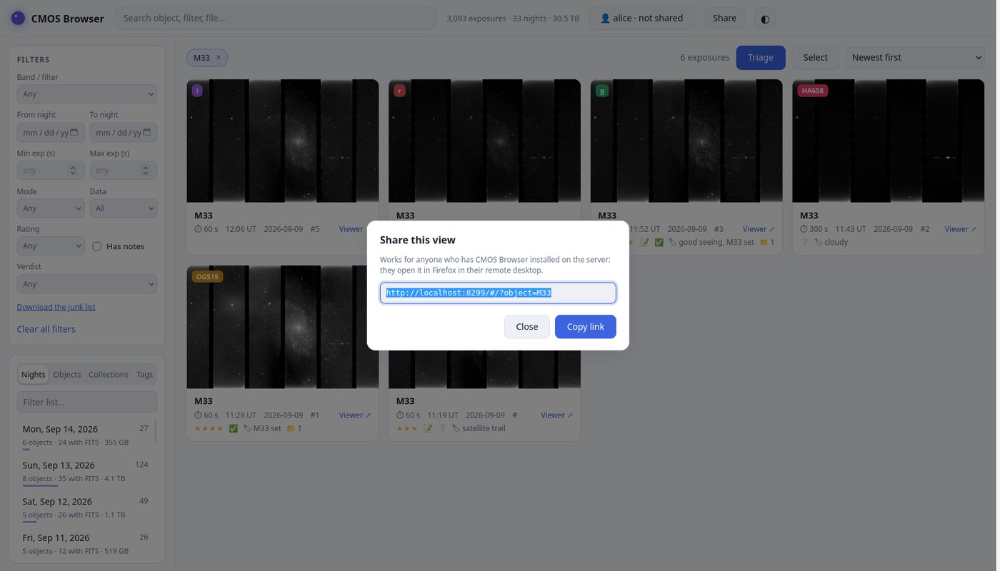

**Share** (top bar) gives you a link to exactly what you're looking at: a
night, a search with filters, or one exposure. Send it to a coworker. They
open it in Firefox in **their** remote desktop, and it opens in their own
copy. Links to collections only work for you, because collections aren't
shared.

## 11. Downloading files and exporting lists

- **One file**: the **Files** tab of an exposure → **Download**. Some files are
  several GB.
- **File paths of a collection**: open the collection → **Export file list**.
- **The junk list**: *Filters* → **Download the junk list**. A text file of every
  photo someone marked Junk: who marked it, who disagreed, and the full paths
  of its files. Give it to whoever owns the data to review; the app never
  deletes anything. Disagreements are listed first.
- **Everything as a spreadsheet**: in the app's address, replace everything
  after the port with `/api/annotations/export.csv` (for example
  `http://localhost:8203/api/annotations/export.csv`). One row per person per
  photo: verdict, rating, tags, note.

## 12. Keyboard shortcuts

**On an exposure's page**

| Key | Does |
|---|---|
| `G` / `J` / `U` | Good / Junk / Unsure (press again to clear) |
| `T` | Add a tag |
| `1`–`5`, `0` | Star rating, clear rating |
| `A` | Apply auto stretch |
| `S` | Show/hide stretch controls |
| `[` `]` | Previous/next frame |
| `P` | Play/pause frames |

**In triage** see [Triage](#7-triage-going-through-many-photos-fast).

**Prefer it dark?** Click **◐** in the top bar.

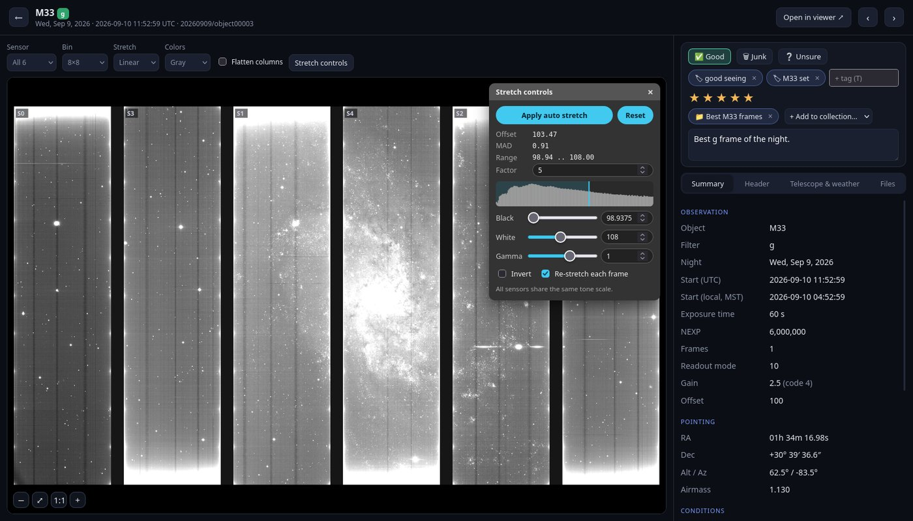

## 13. Troubleshooting

| Problem | What to do |
|---|---|
| The icon shows *"CMOS Browser could not start"* | The window says why. Usually another program has your port: add a line like `port = 8299` (any free number) to `~/cmos-browser/config.local.toml`, then double-click the icon again. |
| Nothing happens when I double-click the icon | Run the installer again (section 2). It repairs the install and keeps your ratings and notes. |
| The top bar says **not shared** | GitHub isn't set up for your copy. Run the installer again. |
| It says **not synced** (red) | Hover over it for the reason. Usually you haven't been invited to the ratings repo yet, or haven't run the installer again since the invitation. |
| A photo says **no access** | Your account isn't allowed to read those files. Ask the data owner. |
| The gallery is empty | In a terminal: `~/cmos-browser/run.sh index`, then reload the page. |
| I don't know my app's address | In a terminal: `~/cmos-browser/run.sh status` |
| Something else broke | Look at `~/cmos-browser/server.log`, then `~/cmos-browser/run.sh restart`. If it's still broken, ask the maintainer. |
